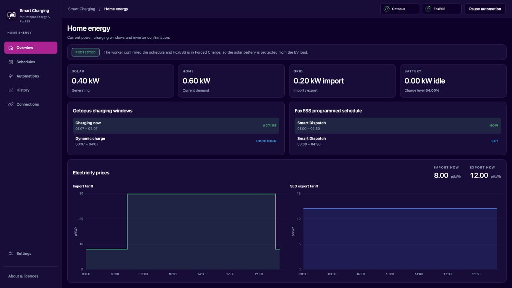
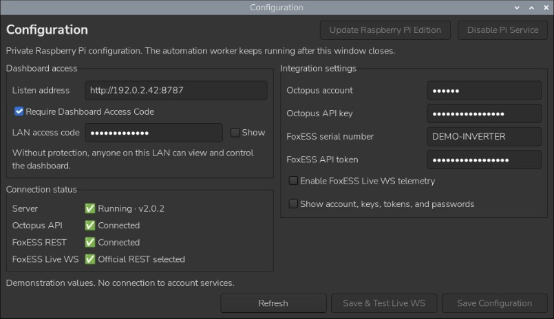
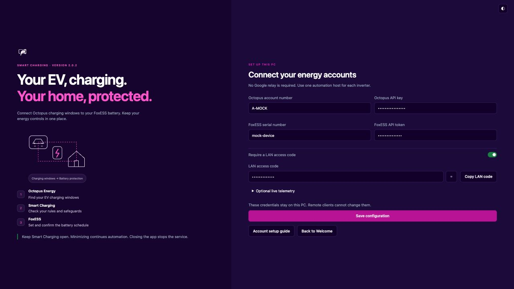
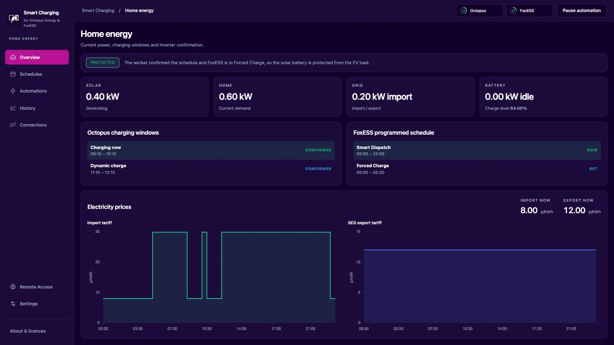
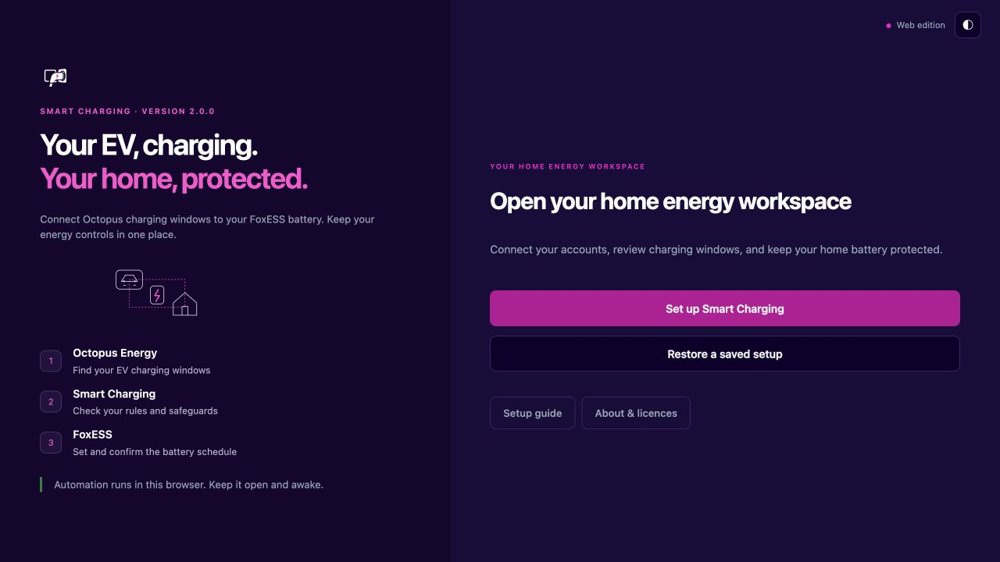
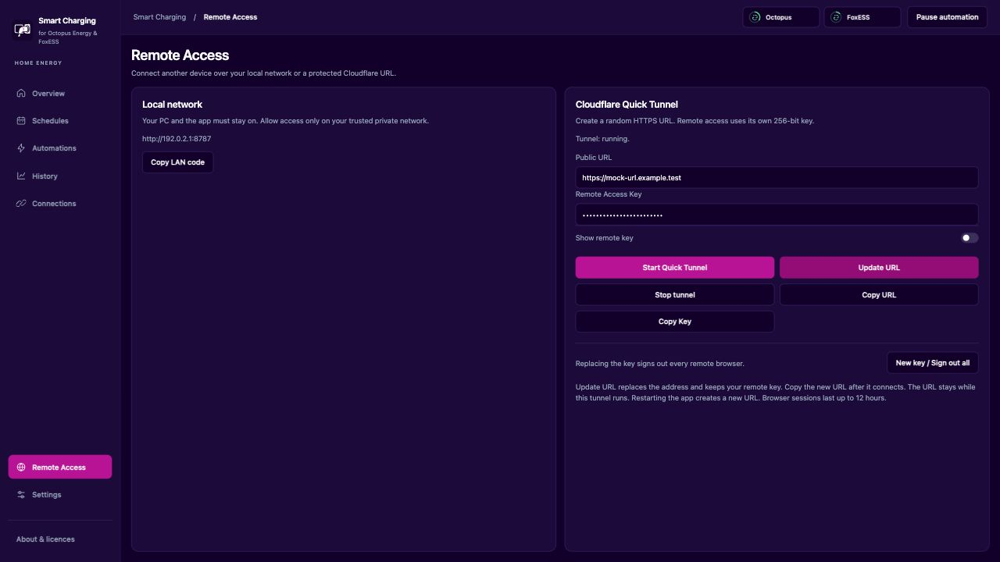
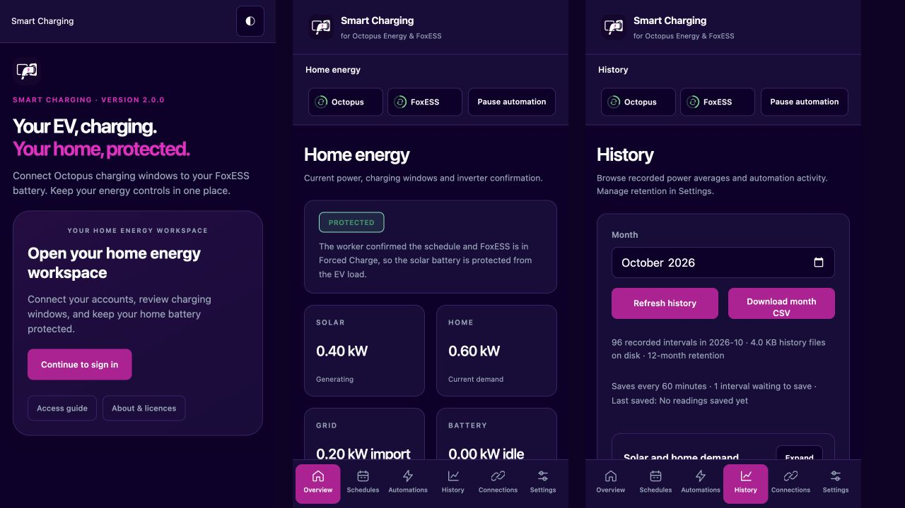
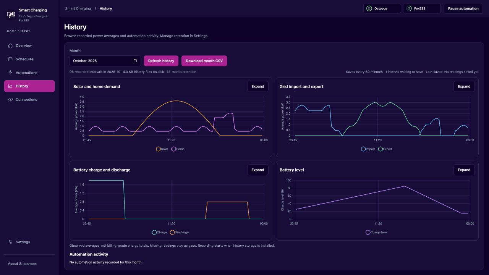

# Smart Charging for Octopus Energy and FoxESS

**Keep your home battery available for your home while your EV charges.**

Intelligent Octopus Go can add or change EV charging windows throughout the day.
A FoxESS inverter in Self-Use mode can supply that charging load from your home battery.
This can leave less stored energy for the house.

Smart Charging connects those Octopus windows to your FoxESS inverter.
It requests Force Charge during the relevant windows, applies your battery limits, and checks the programmed schedule through FoxESS REST.
The dashboard shows the requested schedule beside measured power readings, so you can check what the inverter is doing.

This is free, independent software by **SCKC**, released under **GPL-3.0-or-later**.
Octopus Energy and FoxESS do not endorse or support this project.

[](https://github.com/samuelkcc/octopus-foxess-smart-charging/releases/latest)
[](LICENSE)
[](https://samuelkcc.github.io/octopus-foxess-smart-charging/)

[**Open the web app**](https://samuelkcc.github.io/octopus-foxess-smart-charging/) · [**Download v2.0.0**](https://github.com/samuelkcc/octopus-foxess-smart-charging/releases/tag/v2.0.0)



## Choose how to run it

| | Raspberry Pi | Windows portable | Standalone web |
|---|---|---|---|
| Runs automation | Always-on background worker | Embedded worker while the app stays open | This browser while it stays open and awake |
| Main interface | Desktop, phone, or tablet browser | Built-in desktop dashboard | Hosted website or downloaded HTML |
| FoxESS connection | Built-in local relay | Built-in local relay | Your Google Apps Script relay |
| Account setup | Native Pi Configuration | Welcome or Settings in the Windows app | Guided browser setup |
| Remote phone access | LAN or protected Cloudflare URL | LAN or protected Cloudflare URL | Separate browser setup |
| Power history | Compressed files on the Pi | Compressed files on the PC | No host power-history archive |

The phone interface is a client of your Pi or Windows host.
It uses the host's settings and data.
It does not need another Octopus API key or another automation worker.

Use one active automation host for each inverter.
Before testing another edition, select **Disable Pi Service** in native Pi Configuration.
**Pause automation** stops schedule control but keeps monitoring active.

## What is new in v2.0.0

- **One interface across desktop and mobile.** Dark and light themes, a compact phone Welcome screen, consistent controls, and an About drawer.
- **Windows portable app.** The dashboard, local service, worker, and tunnel client run together in one app.
- **Remote Access.** Open your Pi or Windows dashboard through a random HTTPS URL with a separate 256-bit key.
- **Power history.** View solar, home demand, grid import/export, battery power, and charge level together. Expand any chart or export a month.
- **Controlled storage use.** Compressed monthly files, configurable retention, hourly saves, disk-space reporting, and low-space cleanup.
- **Pause and resume.** Choose 6, 12, or 24 hours, or pause until you resume. A red banner and history entry show the change.
- **API status and refresh.** Header badges show health and interval progress. Select a badge to request an update.
- **Retained problem alerts.** A recovered incident stays visible until you review and clear it.
- **Simpler return visits.** Saved web setup opens with Connect. Windows includes account setup instructions and local service controls.

## Get started

### Raspberry Pi

Raspberry Pi OS with a graphical desktop and systemd is required.
The installer creates the local server, background worker, and taskbar controls.

- Open a terminal on the Pi.
- Run:

```sh
curl -fsSL https://raw.githubusercontent.com/samuelkcc/octopus-foxess-smart-charging/main/linux/install.sh | sudo sh
```

- Open the charger icon in the Pi taskbar.
- Select **Configuration…**.
- Enter your Octopus and FoxESS details.
- Save the configuration.
- Select **Open Desktop Client**, or open the displayed LAN address on another device.
- Review your automation rules before enabling them.

The worker continues after you close the dashboard or Configuration window.
The taskbar **Update Raspberry Pi Edition** action installs the latest public release.
Updates retain the existing configuration and history directory.

[Read the Pi installation and update guide](linux/README-RASPBERRY-PI.md).



### Windows portable

- Download [SmartCharging-2.0.0-Windows-x64.exe](https://github.com/samuelkcc/octopus-foxess-smart-charging/releases/download/v2.0.0/SmartCharging-2.0.0-Windows-x64.exe).
- Open the EXE.
- Read the licence notice.
- Select **Accept and Continue**.
- Select **Configure this PC** from Welcome.
- Use **Account setup guide** to find your account details.
- Save the configuration and open the dashboard.

No Google Apps Script relay is needed.
Keep the PC and app running for automation and remote access.
Minimizing the app continues operation.
Closing the app stops its worker, server, and tunnel.
Settings and history remain in your Windows user profile when you replace the EXE.

The portable binary targets Windows x64 and is currently unsigned.

[Read the Windows guide](desktop/README.md).

| Windows host setup | Windows dashboard and remote access |
|---|---|
|  |  |

### Web app or downloaded HTML

**Create your Google relay once:**

- Open [Google Apps Script](https://script.google.com/) and create a project.
- Copy the relay code from the [web guide](docs/WEB-GUIDE.md#create-the-relay).
- Select **Deploy → New deployment → Web app**.
- Set **Execute as: Me** and **Who has access: Anyone**.
- Deploy, authorize your Google account, and copy the URL ending in `/exec`.

**Connect the web app:**

- Open the [hosted web app](https://samuelkcc.github.io/octopus-foxess-smart-charging/).
- Select **Set up Smart Charging**.
- Enter your Octopus and FoxESS details.
- Add your Google Apps Script Web App URL.
- Select **Connect**.

You can also [download the standalone HTML](https://github.com/samuelkcc/octopus-foxess-smart-charging/releases/latest/download/Octopus_IGO_Smart_Charging_Detector.html).
On later visits, saved setup gives you a Connect button.
Select **Modify setup** when you need to change a value.
Keep this browser open and awake while automation runs.

[Read the complete web and Google relay guide](docs/WEB-GUIDE.md).



## Find your account details

- **Octopus:** copy your account number and key from [API Access](https://octopus.energy/dashboard/new/accounts/personal-details/api-access).
- **FoxESS:** open [FoxESSCloud](https://www.foxesscloud.com/login), then **User Profile → API Management** for your token.
- Copy the inverter serial number from **Device → Inverter**.
- Optional Live WS uses separate FoxCloud login details. Official REST works without it.

## Use Cloudflare remote access

Cloudflare Quick Tunnel creates a free, random HTTPS address for your running host.
You do not need your own domain or router port forwarding.
Remote access always uses its own key, even when LAN protection is off.

### Open the remote dashboard

- On Pi, select **Remote Access…** from the charger taskbar menu.
- On Windows, open **Remote Access** above Settings.
- Select **Start Quick Tunnel**.
- Copy the public URL.
- Select **Copy Key**.
- Open the URL on your phone or other computer.
- Enter that Remote Access Key.

On Pi Connect, use the app's **Copy Key** button first.
Then select Pi Connect's **Copy from remote** to transfer the clipboard to your computer.
Copying the masked field can copy dots instead of the key.

### Understand the URL and login lifetime

| Item | What happens |
|---|---|
| Public URL | Stays the same while that tunnel process keeps running. |
| Reboot, app/service restart, or tunnel restart | Creates a new random URL. An automatic tunnel recovery can also change it. |
| Closing a dashboard browser | Does not stop a Pi tunnel or change its URL. The host must remain running. |
| Browser login | Expires after up to 12 hours. Sign in again with the same key. |
| Remote Access Key | Stays valid until you replace it. It does not expire with the browser session. |
| New key / Sign out all | Replaces the key and invalidates existing remote sessions. |
| iOS Home Screen shortcut | Keeps the saved URL. Replace it when the tunnel URL changes. |

**Set up Raspberry Pi Connect before you depend on the public URL.**
If a reboot changes the URL, sign in to [Pi Connect](https://connect.raspberrypi.com/).
Open your Pi desktop, then open the charger icon's **Remote Access…** window.
Copy the current URL and key there.

[Official Pi Connect setup](https://www.raspberrypi.com/documentation/services/connect.html) · [Cloudflare Quick Tunnel documentation](https://developers.cloudflare.com/cloudflare-one/networks/connectors/cloudflare-tunnel/do-more-with-tunnels/trycloudflare/)

Quick Tunnel is a temporary access service with no uptime guarantee.
Cloudflare handles the HTTPS connection, including remote-login traffic.
Remote browsers cannot manage host credentials, rotate keys, or perform native Pi administration.





## History without frequent SD-card writes

Pi and Windows record compact 15-minute power averages and automation activity.
The History page shows all measurements together and reports storage use.
These are observed averages, not billing-grade energy totals.
Missing readings stay as gaps.

- Retention defaults to **12 months**, with a configurable range of **1–24 months**.
- Readings are buffered in memory and saved every **60 minutes** by default. A **30-minute** option is available.
- Monthly archives are compressed. Unsaved readings can be lost after an unexpected power failure.
- Below **4 GB free disk space**, Overview shows a warning and the oldest history is removed early.
- Settings includes **Keep recent 3 months** and **Clear all history** actions.



History is separate from account configuration.
Clearing history does not remove your account details or automation rules.

## Automation and API safeguards

- Changed valid Smart Dispatch schedules reconcile immediately, before tariff work.
- Smart Dispatch has priority over ordinary charge/discharge rules.
- Invalid responses retain the last valid dispatch.
- Fresh FoxESS REST readback confirms programming. Power measurements show actual behaviour.
- Operator pause blocks all app schedule writes.
- Pi dashboard clients read host snapshots without another Octopus login or a 60-second queue.
- Pi outbound Octopus requests have a shared 60-second minimum gap.
- Web and Windows login have no artificial gap. Actual API rate limits still apply.
- Routine settings cannot go below **60 seconds for Octopus** or **600 seconds for FoxESS**.

[Read the architecture and safety details](docs/ARCHITECTURE.md).

## Security, licence, and maintenance

Host credentials stay on the Pi or Windows PC.
The web edition saves encrypted setup in your browser and uses your own Google relay.
Use one active automation host per inverter.

[GPL-3.0-or-later licence](LICENSE) · [Third-party notices](THIRD_PARTY_NOTICES.md) · [Release notes](RELEASE_NOTES.md)

The optional Live WS module includes Nick Farrell's [foxess-control](https://github.com/nicois/foxess-control) work.
Company names belong to their owners. This independent software has no warranty.

### Build from source

- Install Node.js 22 or later.
- Run `npm ci`.
- Run `npm ci --prefix desktop`.
- Run `npm run build:release`.

The final `dist` folder contains one HTML file and one Windows EXE.
Pi packages, checksums, and intermediate build files remain in `.build`.

[Architecture](docs/ARCHITECTURE.md) · [Feature verification](docs/FEATURE-PARITY.md) · [Writing guide](docs/WRITING.md)

Screenshots use demonstration data and contain no real account credentials or device identifiers.
The Pi Configuration screenshot uses the native Pi interface with demonstration values.

## Support the project ☕

If Smart Charging helps you, you can support its maintenance and future improvements.

[](https://buymeacoffee.com/samuelchen)
