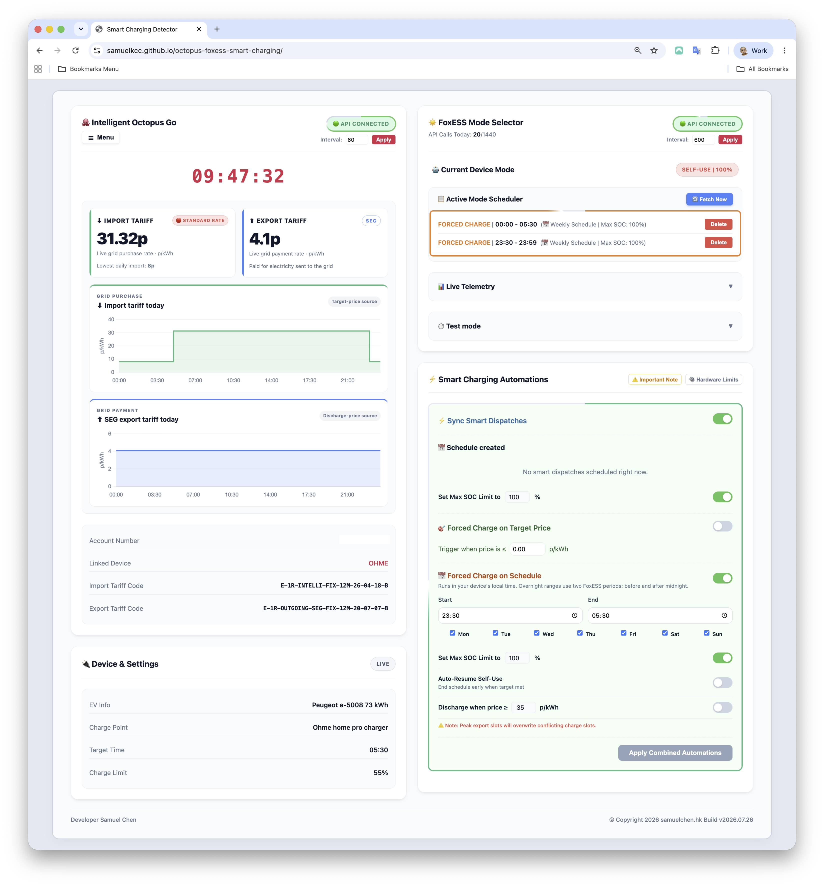

# Smart Charging for Octopus Energy and FoxESS

This app controls a FoxESS home battery during Intelligent Octopus Go EV charging.
It reads Octopus charging windows and sets the FoxESS schedule.
It also supports price rules and weekly schedules.

The app is independent software by SCKC.
Octopus Energy and FoxESS do not endorse or support this project.

The public release is **v2026.10.26.5**.
This branch contains **2026.10.26.7 DEV**.
The new interface is under review on the Pi.
GitHub Pages still uses the public interface.

## Choose an edition

| Item | Pi edition | Web edition |
|---|---|---|
| Automation | The Pi worker runs continuously. | The browser must stay open and awake. |
| Account credentials | The Pi stores them. | The browser stores them. |
| FoxESS relay | The Pi provides it. | Your Google Apps Script project provides it. |
| Phone access | LAN code or separate remote key. | Account setup on each browser. |
| Live telemetry | Live WS or official REST. | Official REST. |
| History in DEV | 12 months by default, configurable up to 24. | Pause activity in this browser. |

[Open the public web app](https://samuelkcc.github.io/octopus-foxess-smart-charging/).

[Download the public HTML file](https://github.com/samuelkcc/octopus-foxess-smart-charging/releases/latest/download/Octopus_IGO_Smart_Charging_Detector.html).

Use only one active automation browser in the web edition.
The Pi edition uses one worker for all dashboard clients.

## Read the guides

- [Pi installation, access, and updates](linux/README-RASPBERRY-PI.md)
- [Web login and Google relay setup](docs/WEB-GUIDE.md)
- [DEV installation and review](dev/README.md)
- [Code boundaries and maintenance](docs/ARCHITECTURE.md)
- [Feature review before release](docs/FEATURE-PARITY.md)
- [ASD-STE100 writing rules for this project](docs/WRITING.md)

## Automation rules

Smart Dispatch has priority by default.
A changed valid dispatch starts schedule reconciliation before tariff work.
A failed Octopus request does not erase the last valid dispatch.

Charging and discharging must not use the same minute.
Outside a Smart Dispatch, a discharge rule can replace an ordinary charge rule.
The safeguards in Automations control this priority.

Auto-Resume can end a target-price or weekly charge at its target charge level.
It does not cancel an active Smart Dispatch.

FoxESS accepts no more than five active schedule periods.
The app merges compatible periods.
Smart Dispatch keeps priority if the schedule exceeds that limit.
A partial schedule must not appear fully confirmed.

The app rounds a dispatch start down to a half-hour boundary.
It rounds the end up to a half-hour boundary.
For example, a start time of 18:11 uses the 18:00 boundary.

On the Pi, the worker owns the current dispatch state.
The dashboard displays that state.
The worker confirms a schedule only after a matching official REST readback.
That confirmation does not replace measured power data.

## Account information

The app needs your Octopus account number and API key.
[Octopus API Access](https://octopus.energy/dashboard/new/accounts/personal-details/api-access) provides that information.

The app also needs your FoxESS inverter serial number and API token.

1. Sign in to the [FoxESSCloud V1 website](https://www.foxesscloud.com/login).
2. Open the user profile menu.
3. Select **User Profile**.
4. Select **API Management**.
5. Open **Private Token**.
6. Select **Generate API key**.
7. Save the new token in a private location.
8. Enter the token in the app's **FoxESS API Token** field.
9. Open **Device → Inverter** in FoxESSCloud.
10. Copy the value in **Inverter SN**.
11. Enter that value in **FoxESS Inverter Serial Number**.

FoxESS may not show the complete token again.
Optional Pi Live WS access uses separate FoxCloud web-login details.

## Security and privacy

The Pi encrypts service credentials and automation settings in its data directory.
Dashboard clients do not receive service API keys or FoxCloud passwords.
The optional LAN access code and Remote Access Key are different credentials.

The web edition encrypts saved credentials with AES-GCM.
It stores the encryption key in IndexedDB.
It uses session storage if persistent secure storage is unavailable.
GitHub Pages does not store your account setup.

The web edition sends Octopus requests to the Octopus API.
Signed FoxESS requests pass through your Google relay.
That relay sends the requests to FoxESS Cloud.

An exported configuration file is a separate encrypted backup.
The app cannot erase copies of that file when you remove browser data.

## Build and check

Node.js 18 or later is required.

1. Run `npm ci`.
2. Run `npm run check`.
3. For the new interface, run `npm run build:dev`.

The build files are in `dist/`.
The Pi and web DEV files are separate from the public build.
A push to `main` can deploy GitHub Pages.
A `v` tag can create public release files.

## Licence and acknowledgements

Copyright (C) 2026 SCKC.
The application uses GPL-3.0-or-later.
The [complete licence](LICENSE) defines the terms.

The optional Live WS module uses work from Nick Farrell's [foxess-control project](https://github.com/nicois/foxess-control).
[Third-party notices](THIRD_PARTY_NOTICES.md) identify component licences.
The app includes the complete licence and component notices.
