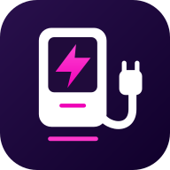
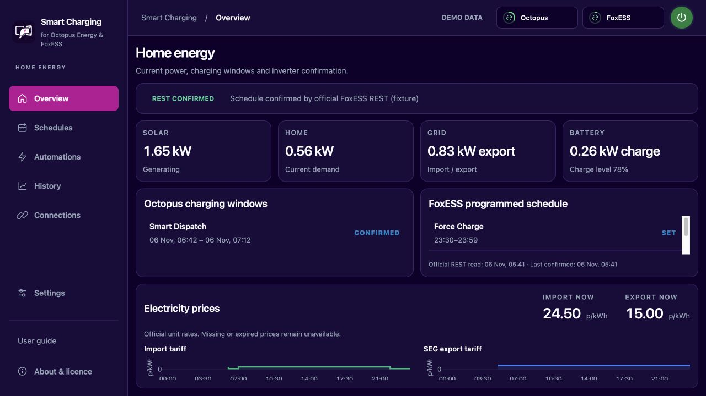
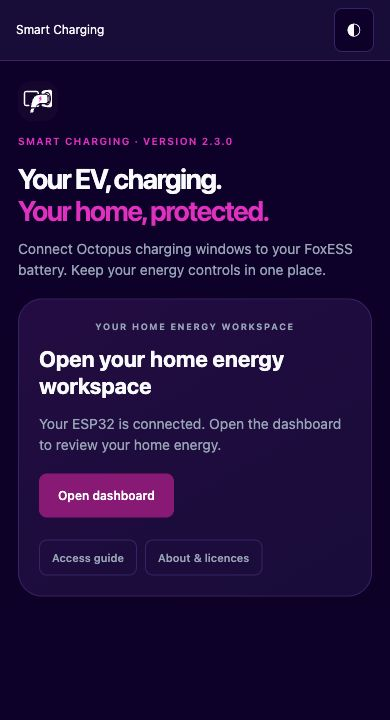

# Smart Charging — for Octopus Energy and FoxESS

### Your EV, charging. Your home, protected.

A free, open-source home energy controller and dashboard.
When Intelligent Octopus Go allocates low-cost EV charging windows, Smart Charging schedules the home solar-storage battery to charge alongside the EV.
FoxESS Force Charge prevents the home battery from discharging into the EV during those windows.

**Version 2.5.3 · ESP32, Raspberry Pi, Windows Portable and Web**

Independent hobby software by SCKC. Not affiliated with Octopus Energy or FoxESS.

 

[ESP32 guide](docs/editions/ESP32.md) · [Prepare your accounts](docs/ACCOUNT-PREPARATION.md) · [Compare editions](#choose-your-setup-guide) · [Downloads](https://github.com/samuelkcc/octopus-foxess-smart-charging/releases/tag/esp32-2.5.3)

## Why this project exists

Intelligent Octopus Go can add or change EV charging windows throughout the day.
A FoxESS inverter in Self-Use mode can supply that charging load from your home battery.
This can leave less stored energy for your house, even when the EV has a low-cost charging window.

Smart Charging connects those Octopus windows to your FoxESS inverter.
It uses **FoxESS Mode Scheduler** to request **Force Charge** during relevant EV charging windows.
This prevents Self-Use from supplying that EV load from the home battery.
The design charges the home solar-storage battery alongside the EV during those low-cost periods, subject to your configured charge limits.
The app checks the programmed schedule through official FoxESS REST readback.

**Required FoxESS settings:** enable **Mode Scheduler** and set **Remaining Time Mode → Self-Use** in the FoxESS app or website.
Outside scheduled periods, Self-Use restores normal home-battery operation.
[Prepare the inverter](docs/PREPARE-INVERTER.md) before enabling Smart Charging automation.
The dashboard shows charging windows beside measured power, so you can check what the inverter is doing.

This free hobby project by **SCKC** puts your home energy controls in one place.
**ESP32 is the main independent local controller.** Pi, Windows Portable, and browser editions provide alternative ways to run it.

## ESP32: a small controller for everyday use

After USB setup, keep the ESP32 powered and disconnect your setup computer.
Your phone, tablet, or computer displays the same worker data from the board.

- **Works independently:** keep the ESP32 powered after USB setup. Your setup computer can disconnect.
- **GitHub OTA updates:** install future firmware from local Settings over Wi-Fi after the first USB installation.
- **Automatic update handling:** control suspends during OTA and resumes its saved state after verified startup. Manual Pause remains active.
- **One dashboard across devices:** view power, battery level, schedules, and electricity prices on your local network.
- **Rules you control:** follow Smart Dispatch, set weekly periods, apply price rules, and pause automation deliberately.
- **Check the result:** official FoxESS REST readback confirms schedule programming. Measured power shows actual battery behaviour.

<table>
<tr><th>Desktop dashboard</th><th>Mobile dashboard</th></tr>
<tr>
<td width="72%" valign="top"></td>
<td width="28%" valign="top"></td>
</tr>
</table>

Screenshots use demonstration data. [Open the interface gallery](docs/INTERFACE.md) for more views.

**Supported board: ESP32-S3 N16R8 — 16 MB Flash and 8 MB Octal PSRAM.** Other ESP32 models are unsupported.
Use a USB data cable and 2.4 GHz Wi-Fi.
New setup and reinstall erase board settings and History. Use Edit settings to retain your configuration.
ESP32 is local-network only. **Cloudflare remote access and Bluetooth setup are not supported.**

[**ESP32 setup guide →**](docs/editions/ESP32.md) · [Mac and Windows deployment apps](docs/editions/ESP32.md#choose-a-deployment-tool) · [View more screenshots](docs/INTERFACE.md)

## Before you start

Prepare these account details before opening setup. All editions need the Octopus and FoxESS REST credentials.

| Prepare | Where to get it |
|---|---|
| **Octopus account number and API key** | Sign in to your [Octopus account](https://octopus.energy/dashboard/). Open **Personal details → Developer settings → API access**. Copy your API key and account number. [Detailed instructions](docs/ACCOUNT-PREPARATION.md#octopus-account-and-api-key). |
| **FoxESS inverter serial number and API token** | Sign in to [FoxESS Cloud](https://www.foxesscloud.com/). Open **User profile / Personal centre → API management**. Generate or copy your API key. Use the inverter serial from your device details. [Detailed instructions](docs/ACCOUNT-PREPARATION.md#foxess-inverter-and-rest-api-token). |
| **Optional FoxESS cloud username and password** | Use your normal FoxESS Cloud web-login details. These enable optional WebSocket telemetry on ESP32, Pi, and Portable. They do not replace the REST API token. [When to use this](docs/ACCOUNT-PREPARATION.md#optional-foxess-websocket-login). |

Keep keys and passwords private. Enter them only in your chosen setup tool.
If another worker controls this inverter, disable it before enabling the new host.
[Prepare the inverter](docs/PREPARE-INVERTER.md) before enabling automation.

## Choose your setup guide

Choose the host that fits your setup. Each column links to its own focused installation guide.

| | **ESP32 — local controller** | **Raspberry Pi** | **Windows Portable** | **HTML Dashboard** |
|---|---|---|---|---|
| Setup guide | [ESP32 guide](docs/editions/ESP32.md) | [Pi guide](linux/README-RASPBERRY-PI.md) | [Portable guide](desktop/README.md) | [HTML guide](docs/WEB-GUIDE.md) |
| Best fit | Small, independent controller | Always-on service with optional remote access | A Windows computer that stays on | Try browser operation without installing an app |
| Runs automation | On the powered ESP32 | On the Pi worker | While the app runs | While the browser stays open and awake |
| Initial setup | USB website, Mac app, or Windows EXE | Native Pi Configuration | App setup | Browser setup and your Google relay |
| Phone dashboard | Same local network | LAN or protected remote connection | LAN or protected remote connection | Current browser session |
| FoxESS telemetry | REST; optional WebSocket | REST; optional WebSocket | REST; optional WebSocket | REST through your relay |
| History | RAM; optional hourly Flash saving for 60 days | Compressed power History | Compressed power History | Browser Activity |
| Firmware updates | GitHub OTA over Wi-Fi; initial USB installation required | Pi updater | Download the updated app | Reopen the hosted page or download HTML |
| Cloudflare remote access | **Not supported** | Optional protected Quick Tunnel | Optional protected Quick Tunnel | Not a remote host |
| Account changes | Local Account setup or USB | Native Pi Configuration | Account setup tab | Browser setup |
| Wi-Fi and IP changes | **USB setup only** | Operating system | Operating system | Operating system |

[Compare the editions](docs/USER-GUIDE.md#1-choose-an-edition) · [User guide](docs/USER-GUIDE.md) · [Downloads](https://github.com/samuelkcc/octopus-foxess-smart-charging/releases/tag/esp32-2.5.3)

## Licence and acknowledgements

Created by **SCKC** as an independent, open-source hobby project.
Smart Charging is released under [GPL-3.0-or-later](LICENSE), without warranty.

Chart.js, CryptoJS, Electron, and ws retain MIT licensing.
ESP-IDF and esptool-js retain Apache-2.0 and their bundled component terms.
Optional cloudflared retains Apache-2.0 on supported computer hosts.
Other bundled components retain their original licences.

The optional FoxESS signature integration adapts work by [Nick Farrell](https://github.com/nicois/foxess-control), under MIT.
Complete original notices are available in **About & licence**, the [third-party notices](THIRD_PARTY_NOTICES.md), and the [ESP32 SDK notices](esp32/SDK_NOTICES.txt).

Smart Charging is independently developed by SCKC.
It is not made by, authorised, sponsored, endorsed, or supported by Octopus Energy or FoxESS.
Product and company names belong to their respective owners.

[Report an issue](https://github.com/samuelkcc/octopus-foxess-smart-charging/issues) · [Verification record](docs/FEATURE-PARITY.md) · [Architecture](docs/ARCHITECTURE.md)

## Support the project

Smart Charging is an independent hobby project by SCKC.
If it helps protect your home battery, you can support its ongoing development by buying Samuel a coffee.

