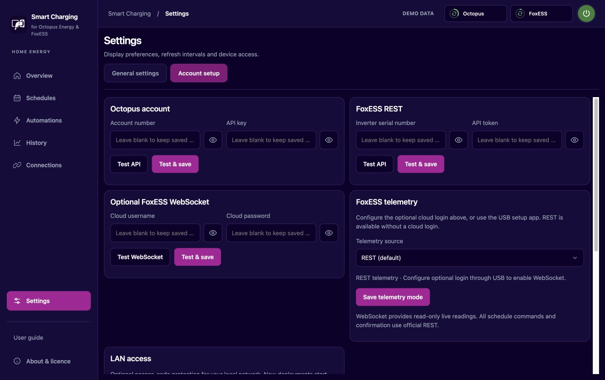
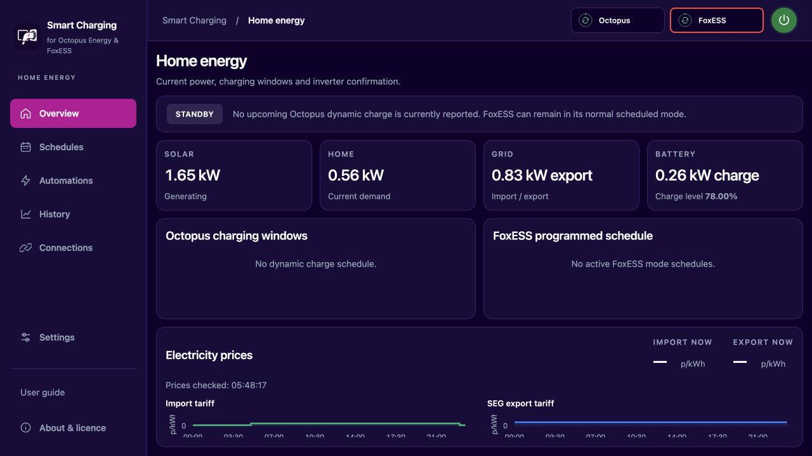
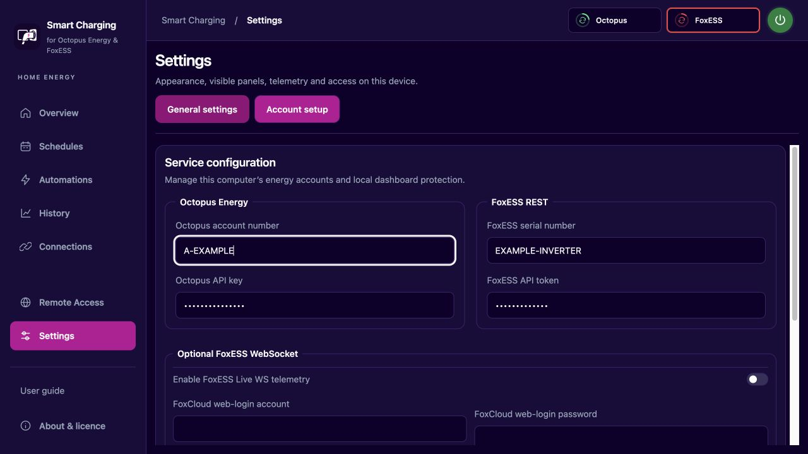
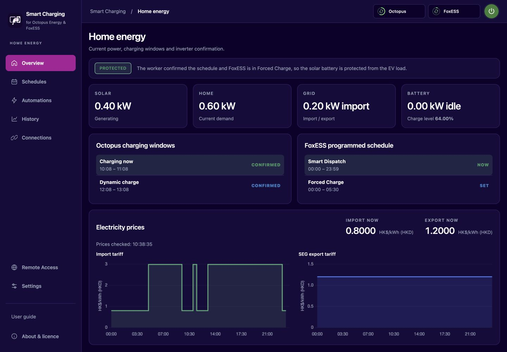
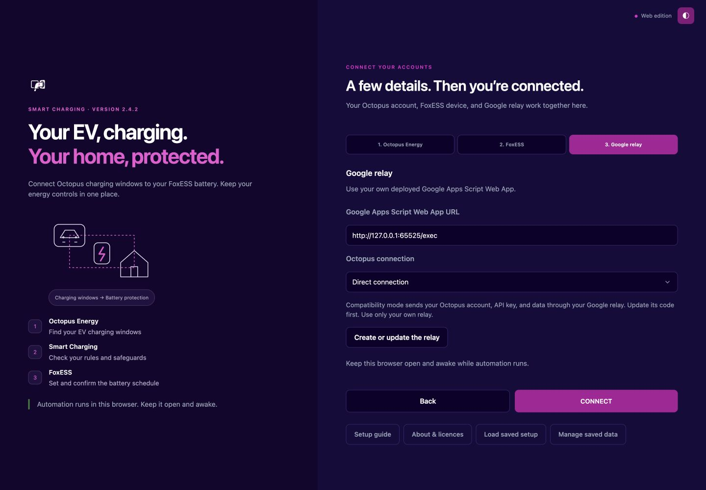
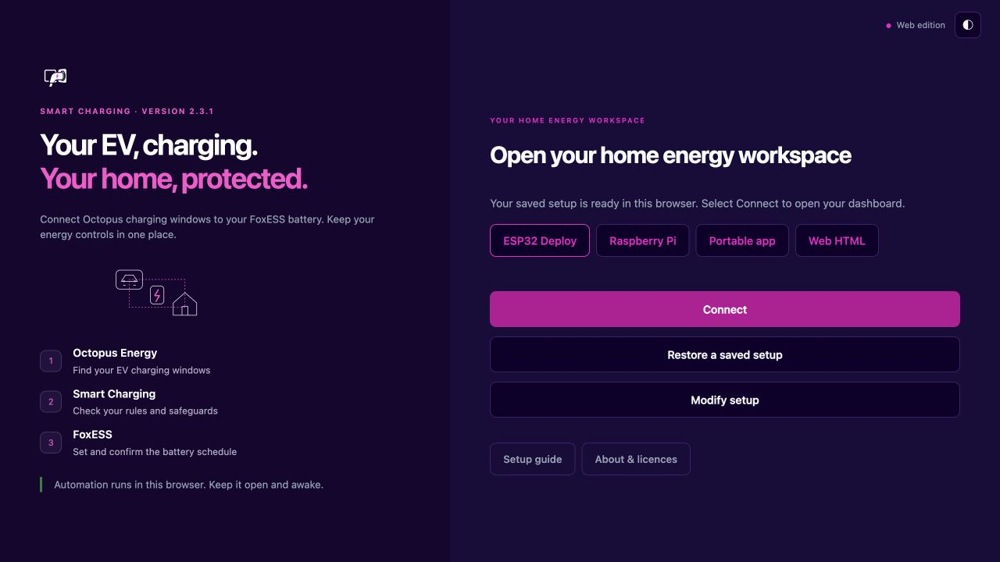
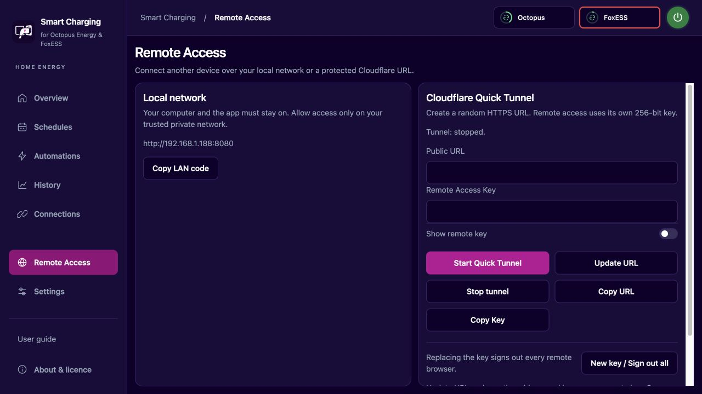
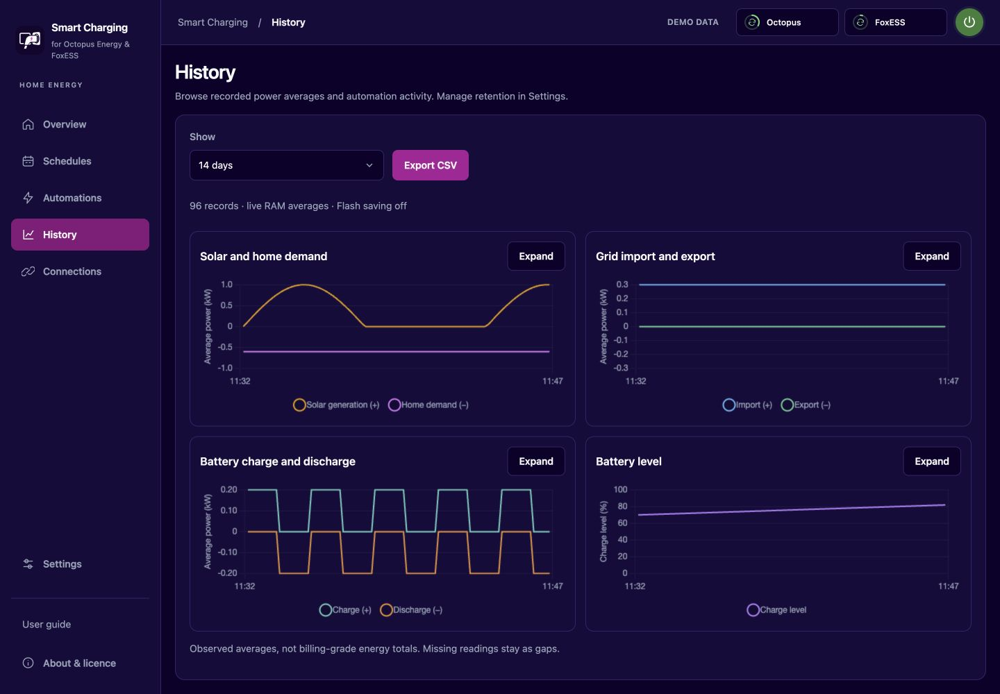
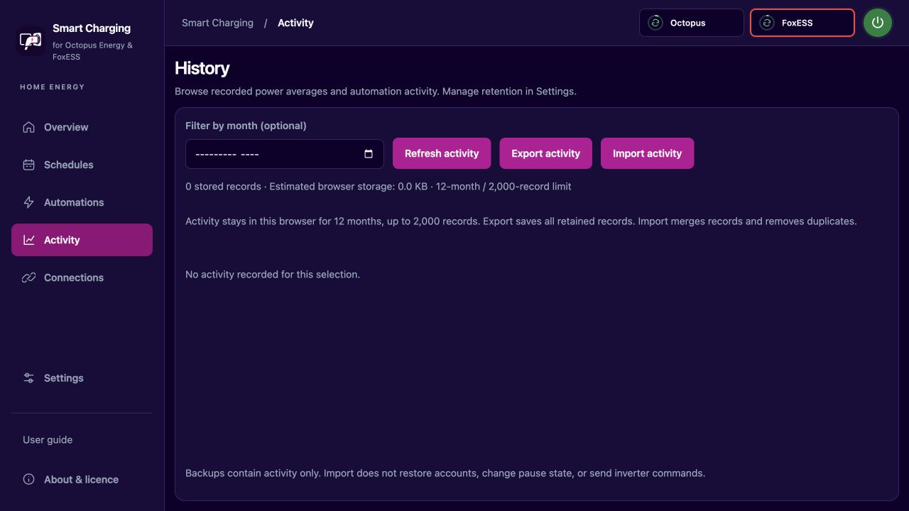

# Smart Charging for Octopus Energy and FoxESS

**Keep your home battery available for your home while your EV charges.**

Intelligent Octopus Go can add or change EV charging windows throughout the day.
A FoxESS inverter in Self-Use mode can supply that charging load from your home battery.
This can leave less stored energy for the house.

Smart Charging connects those Octopus windows to your FoxESS inverter.
It requests Force Charge during the relevant windows, applies your battery limits, and checks the programmed schedule through FoxESS REST.
The dashboard shows the requested schedule beside measured power readings, so you can check what the inverter is doing.

This is free, independent software by **SCKC**, released under **GPL-3.0-or-later**.
Octopus Energy and FoxESS do not endorse or support this project.

[](LICENSE)
[](https://samuelkcc.github.io/octopus-foxess-smart-charging/)

[**Deploy ESP32 over USB**](https://samuelkcc.github.io/octopus-foxess-smart-charging/esp32/) · [**ESP32 setup apps and preview downloads**](https://github.com/samuelkcc/octopus-foxess-smart-charging/releases/tag/esp32-preview-2.3.0) · [**Open Web HTML**](https://samuelkcc.github.io/octopus-foxess-smart-charging/)


[User guide](docs/USER-GUIDE.md) is available in each dashboard and ESP32 setup tool.
It includes a dedicated [ESP32 deployment chapter](docs/USER-GUIDE.md#3-deploy-esp32).

## Choose how to run it

| | ESP32 | Raspberry Pi | Portable app | Web HTML |
|---|---|---|---|---|
| Automation host | Powered ESP32-S3 N16R8 | Always-on Pi worker | Windows or macOS app while open | Browser while open and awake |
| Dashboard | Phone or computer on the same LAN | Phone or computer | Built-in dashboard and LAN clients | This browser |
| Initial setup | USB website, Mac app, or Windows EXE | Native Pi Configuration | Welcome or Account setup tab | Guided browser setup |
| Account changes | Local Settings → Account setup or USB | Native Pi Configuration | App Settings → Account setup | Browser setup |
| General preferences | General settings tab | General settings tab | General settings tab | General settings tab |
| FoxESS connection | Built-in REST, optional WebSocket | Built-in REST, optional WebSocket | Built-in REST, optional WebSocket | Your Google Apps Script relay |
| Cloudflare remote access | **Not supported** | Optional protected Quick Tunnel | Optional protected Quick Tunnel | Not a remote host |
| Records | RAM, optional hourly Flash for 60 days | Compressed power History | Compressed power History | Browser Activity |
| Bluetooth | Disabled | Not required | Not required | Not required |
| Firmware updates | Physical USB | Pi updater | Replace the app | Refresh or replace HTML |
| Status | ESP32 Preview, with documented limits | Stable edition | Stable host with updated preview UI | Updated preview UI |

A phone dashboard uses the host's settings and cached data.
It does not start another automation worker.
Use only one active automation host for each inverter.
Before changing hosts, disable the previous worker.

## ESP32: start here

The ESP32 runs independently after USB setup. Your Mac or PC can then be disconnected.
Supported hardware is **ESP32-S3 N16R8**, with **16 MB Flash and 8 MB Octal PSRAM**.
Other ESP32 models are unsupported.

1. Connect the board with a USB data cable.
2. Open the [USB deployment website](https://samuelkcc.github.io/octopus-foxess-smart-charging/esp32/), or the Mac or Windows setup app.
3. Complete Device, Network, Accounts, and Verify & save.
4. Wait for all required checks to pass.
5. Open the displayed local IP on your phone or computer.

Desktop Chrome or Edge is required for USB setup in a browser.
The native Mac and Windows setup tools provide the same four-step flow.
The iPhone dashboard uses Wi-Fi after setup.

| USB deployment website and apps | Local account setup |
|---|---|
|  |  |

**Limits:** Cloudflare remote access, Bluetooth setup, and OTA updates are not supported.
Wi-Fi and IP changes require USB setup. Service credentials can be changed in the local Account setup tab.

This Preview does not establish complete Pi scheduler equivalence.
UK clock-transition handling and advanced Auto-Resume behaviour have documented differences.
Windows execution and long-term Flash endurance require further verification.
See the [ESP32 deployment chapter](docs/USER-GUIDE.md#3-deploy-esp32) and [feature review](docs/FEATURE-PARITY.md).

[Download ESP32 setup apps and all preview editions](https://github.com/samuelkcc/octopus-foxess-smart-charging/releases/tag/esp32-preview-2.3.0).
The existing Pi updater continues to use the stable release.

## What the app does

- **Protect the home battery.** Follow valid Octopus Smart Dispatch windows and request Force Charge on FoxESS.
- **Compare schedules and measured power.** Check Octopus charging windows beside the programmed FoxESS schedule and current readings.
- **Control charging and discharging.** Use price rules, weekly schedules, and battery limits.
- **Pause app control.** Pause for 6, 12, or 24 hours, or until resumed. Monitoring continues.
- **Connect remotely on supported hosts.** Open a Pi, Windows, or macOS dashboard through a protected Cloudflare URL.
- **Review power history.** Compare four charts, expand a chart, or export a month on Pi, Windows, and macOS.
- **Limit storage writes.** Buffer readings in memory, compress monthly files, and remove older history when space is low.
- **Check API health.** Header badges show connection status and refresh progress. A red border opens retained problem details.
- **Use desktop or mobile.** Open the same dashboard on a computer, phone, or tablet.

Version details and changes are listed on each [release download page](https://github.com/samuelkcc/octopus-foxess-smart-charging/releases).

## Get started

### Prepare FoxESS work modes

Complete this setup for all editions.

- Open your inverter's **Work Mode** page in the FoxESS app.
- Under **Advanced**, enable **Mode Scheduler**.
- Open the **Mode Scheduler** settings.
- Set **Remaining Time Mode** to **Self-use**.
- Save the settings.

Mode Scheduler applies the charging periods that Smart Charging programs.
Outside scheduled periods, **Remaining Time Mode** keeps the inverter in **Self-use**.
The scheduler's **Current Work Mode** can change during a scheduled period.

### Raspberry Pi

Raspberry Pi OS with a graphical desktop and systemd is required.
The installer creates the local server, background worker, and taskbar controls.

- Open a terminal on the Pi.
- Run:

```sh
curl -fsSL https://raw.githubusercontent.com/samuelkcc/octopus-foxess-smart-charging/main/linux/install.sh | sudo sh
```

- Open the charger icon in the Pi taskbar.
- Select **Configuration…**.
- Enter your Octopus and FoxESS details.
- Save the configuration.
- Select **Open Desktop Client**, or open the displayed LAN address on another device.
- Review your automation rules before enabling them.

The worker continues after you close the dashboard or Configuration window.
The taskbar **Update Raspberry Pi Edition** action installs the latest public release.
Updates retain the existing configuration and history directory.

[Read the Pi installation and update guide](linux/README-RASPBERRY-PI.md).



#### Uninstall from Raspberry Pi

Uninstallation removes the app, services, taskbar icon, saved credentials, access keys, and history.

- Save any required history or configuration backups.
- Open a terminal on the Pi.
- Run:

```sh
curl -fsSL https://raw.githubusercontent.com/samuelkcc/octopus-foxess-smart-charging/main/linux/uninstall.sh | sudo sh
```

- Check the inverter schedule in the FoxESS app after removal.

Uninstallation does not clear the schedule stored on the inverter.
[Read the Pi removal guide](linux/README-RASPBERRY-PI.md#remove-the-pi-edition).

### Windows portable

- Open the [download page](https://github.com/samuelkcc/octopus-foxess-smart-charging/releases/tag/esp32-preview-2.3.0).
- Download the Windows x64 EXE from **Assets**.
- Open the EXE.
- Read the licence notice.
- Select **Accept and Continue**.
- Select **Configure this computer** from Welcome.
- Use **Account setup guide** to find your account details.
- Use **Settings → Account setup** for later account changes.
- Save the configuration and open the dashboard.

No Google Apps Script relay is needed.
Keep the PC and app running for automation and remote access.
Minimizing the app continues operation.
Closing the app stops its worker, server, and tunnel.
Settings and history remain in your Windows user profile when you replace the EXE.

The portable binary targets Windows x64 and is currently unsigned.

[Read the Windows guide](desktop/README.md).

| Windows host setup | Windows dashboard and remote access |
|---|---|
|  |  |

### Web app or downloaded HTML

**Create your Google relay once:**

- Open [Google Apps Script](https://script.google.com/) and create a project.
- Copy the relay code from the [web guide](docs/WEB-GUIDE.md#create-the-relay).
- Select **Deploy → New deployment → Web app**.
- Set **Execute as: Me** and **Who has access: Anyone**.
- Deploy, authorize your Google account, and copy the URL ending in `/exec`.

**Connect the web app:**

- Open the [hosted web app](https://samuelkcc.github.io/octopus-foxess-smart-charging/).
- Select **Set up Smart Charging**.
- Enter your Octopus and FoxESS details.
- Add your Google Apps Script Web App URL.
- Select **Connect**.

You can also [download the standalone HTML](https://github.com/samuelkcc/octopus-foxess-smart-charging/releases/download/esp32-preview-2.3.0/Smart_Charging_v2.3.0.html).
On later visits, saved setup gives you a Connect button.
Select **Modify setup** when you need to change a value.
Keep this browser open and awake while automation runs.

#### Safari connection

If Safari cannot connect directly to Octopus, select **Safari compatibility — my Google relay** during setup.
This sends Octopus credentials and data through your own Google relay.
Google processes those requests.

- If your relay uses older code, follow the [relay upgrade guide](docs/WEB-GUIDE.md#update-an-existing-relay).
- Open **Modify setup → 3. Google relay**.
- Select **Safari compatibility — my Google relay**.
- Select **Connect**.



[Read the complete web and Google relay guide](docs/WEB-GUIDE.md).



## Find your account details

- **Octopus:** copy your account number and key from [API Access](https://octopus.energy/dashboard/new/accounts/personal-details/api-access).
- **FoxESS:** open [FoxESSCloud](https://www.foxesscloud.com/login), then **User Profile → API Management** for your token.
- Copy the inverter serial number from **Device → Inverter**.
- Optional Live WS uses separate FoxCloud login details. Official REST works without it.

## Use Cloudflare remote access

Cloudflare Quick Tunnel creates a free, random HTTPS address for your running host.
You do not need your own domain or router port forwarding.
Remote access always uses its own key, even when LAN protection is off.

### Open the remote dashboard

- On Pi, select **Remote Access…** from the charger taskbar menu.
- On Windows or macOS, open **Remote Access** above Settings.
- Select **Start Quick Tunnel**.
- Copy the public URL.
- Select **Copy Key**.
- Open the URL on your phone or other computer.
- Enter that Remote Access Key.

On Pi Connect, use the app's **Copy Key** button first.
Then select Pi Connect's **Copy from remote** to transfer the clipboard to your computer.
Copying the masked field can copy dots instead of the key.

### Understand the URL and login lifetime

| Item | What happens |
|---|---|
| Public URL | Stays the same while that tunnel process keeps running. |
| Reboot, app/service restart, or tunnel restart | Creates a new random URL. An automatic tunnel recovery can also change it. |
| Closing a dashboard browser | Does not stop a Pi tunnel or change its URL. The host must remain running. |
| Browser login | Expires after up to 12 hours. Sign in again with the same key. |
| Remote Access Key | Stays valid until you replace it. It does not expire with the browser session. |
| New key / Sign out all | Replaces the key and invalidates existing remote sessions. |
| iOS Home Screen shortcut | Keeps the saved URL. Replace it when the tunnel URL changes. |

If an address stops working, open **Remote Access** on the host.
Select **Update URL**, then wait for the connection.
Copy the new URL.
Your Remote Access Key remains unchanged.
Update saved bookmarks and Home Screen shortcuts.

**Set up Raspberry Pi Connect before you depend on the public URL.**
If a reboot changes the URL, sign in to [Pi Connect](https://connect.raspberrypi.com/).
Open your Pi desktop, then open the charger icon's **Remote Access…** window.
Copy the current URL and key there.

[Official Pi Connect setup](https://www.raspberrypi.com/documentation/services/connect.html) · [Cloudflare Quick Tunnel documentation](https://developers.cloudflare.com/cloudflare-one/networks/connectors/cloudflare-tunnel/do-more-with-tunnels/trycloudflare/)

Quick Tunnel is a temporary access service with no uptime guarantee.
Cloudflare handles the HTTPS connection, including remote-login traffic.
Remote browsers cannot manage host credentials, rotate keys, or perform native Pi administration.

### Manage remote access from the LAN

- In host Configuration, enable **Require a LAN access code**.
- Open the LAN dashboard on your phone or computer.
- Open **Settings → Remote Access → Open Remote Access**.
- Enter the LAN access code.
- Select **Unlock LAN management**.

Verified LAN clients can copy the public URL, replace the URL, reveal the key, or replace the key.
Replacing the key signs out remote browsers.
Management locks after five minutes or when you leave the page.
Cloudflare clients cannot use this management endpoint, including with a valid remote key.
The LAN code grants these management permissions to anyone who knows it.
LAN HTTP is not encrypted. Use a trusted private network or a secure private connection.
If the public URL fails, recover it through the LAN dashboard or Pi Connect.
The app does not send email notifications or include keys in emailed links.




## History without frequent SD-card writes

Pi, Windows, and macOS record compact 15-minute power averages and automation activity.
The History page shows all measurements together and reports storage use.
These are observed averages, not billing-grade energy totals.
Missing readings stay as gaps.

Power charts use positive and negative values to show direction.
Solar generation, grid import, and battery charging appear above zero.
Home demand, grid export, and battery discharging appear below zero.
Battery level remains between 0% and 100%.
CSV exports retain the original recorded magnitudes.

- Retention defaults to **12 months**, with a configurable range of **1–24 months**.
- Readings are buffered in memory and saved every **60 minutes** by default. A **30-minute** option is available.
- Monthly archives are compressed. Unsaved readings can be lost after an unexpected power failure.
- Below **4 GB free disk space**, Overview shows a warning and the oldest history is removed early.
- Settings includes **Keep recent 3 months** and **Clear all history** actions.



History is separate from account configuration.
Clearing history does not remove your account details or automation rules.

## macOS desktop host

The macOS Universal download supports Apple Silicon and Intel Macs.
It includes the same local host and dashboard as the Windows edition.
No GAS relay is required.

- Download the Universal ZIP from [Releases](https://github.com/samuelkcc/octopus-foxess-smart-charging/releases/latest).
- Extract the app.
- Move it to **Applications**.
- Open **Configure this computer** from Welcome.
- Follow the [macOS setup guide](desktop/README-MACOS.md).

Keep the Mac awake and the app open.
This build is ad-hoc signed and is not Apple notarised.
The guide explains first-launch and Keychain considerations.

## Browser Activity and backups

The standalone web edition uses **Activity**, instead of host power History.
It records browser pause, resume, and pause-expiry events.
It retains up to **2,000 records** for **12 months** in browser storage.
Storage use appears on the Activity page.

- Select **Export activity** to save all retained records as JSON.
- Select **Import activity** to merge a previous backup.
- Continue using the same browser to add new activity.
- Export before clearing browser storage or changing browsers.

Imports remove duplicates and apply the same retention limits.
Backups exclude accounts, credentials, access keys, and power measurements.
Import does not restore pause state or send inverter commands.
Pi, Windows, and macOS retain their existing History page.



## Automation and API safeguards

After a Pi restart, initial electricity prices can take several minutes to load through the shared request queue.
The worker publishes tariff data for all dashboards.
Phones and desktop dashboards do not make separate Octopus tariff requests.
Prices and charts update automatically when those requests complete.
After a successful update, the host saves a private display snapshot.
After restart, available prices appear as **Last-known prices** until the worker confirms new data.
Display snapshots expire after 24 hours and never supply automation rules.
The first update after installation must complete before this recovery file exists.
Missing rates show a loading or unavailable message, never a synthetic zero price.

- Changed valid Smart Dispatch schedules reconcile immediately, before tariff work.
- Smart Dispatch has priority over ordinary charge/discharge rules.
- Invalid responses retain the last valid dispatch.
- Fresh FoxESS REST readback confirms programming. Power measurements show actual behaviour.
- Operator pause blocks all app schedule writes.
- Pi dashboard clients read host snapshots without another Octopus login or a 60-second queue.
- Pi outbound Octopus requests have a shared 60-second minimum gap.
- Web and Windows login have no artificial gap. Actual API rate limits still apply.
- Routine settings cannot go below **60 seconds for Octopus** or **600 seconds for FoxESS**.

[Read the architecture and safety details](docs/ARCHITECTURE.md).

### Choose a display currency

- Open **Settings → Price display**.
- Enable **Use a custom display currency**.
- Enter a three-letter currency code and its symbol.
- Enter the exchange rate for **1 GBP**.
- Select **Save price display**.

For example, HKD with an exchange rate of 10 displays 29.82p/kWh as HK$2.9820/kWh.
The rate is manual and applies only to this browser.
Overview prices and price charts use the selected display currency.
Rule inputs remain explicitly labelled in UK p/kWh, with a converted reference value beside each input.
Scheduler comparisons and host snapshots retain the original UK values.
This setting does not add support for Octopus accounts in other countries.

### Save a diagnostic log

- Open **Settings → API refresh intervals → API problem alerts**.
- Select **Save diagnostic log**.

The JSON file contains recent API errors, grouped counts, timestamps, and tariff-loading information.
Only errors create diagnostic entries. The latest 100 groups are retained.
Credentials, account numbers, serial numbers, private URLs, and raw upstream messages are excluded.
Saving this file does not request API data.
It also includes host publication, client receipt, and price-rendering times.
The host retains a maximum of 40 recent Octopus request summaries in memory.
These summaries identify request categories and timing without account identifiers, URLs, or request bodies.
Healthy request summaries are not written to the error journal.
**Electricity price diagnostics → Reload host prices** reads the existing host snapshot without another Octopus request.
Returning to a hosted dashboard also requests its latest price snapshot.

## Security, licence, and maintenance

Host credentials stay on the Pi or Windows PC.
The web edition saves encrypted setup in your browser and uses your own Google relay.
Use one active automation host per inverter.

[GPL-3.0-or-later licence](LICENSE) · [Third-party notices](THIRD_PARTY_NOTICES.md) · [Release notes](https://github.com/samuelkcc/octopus-foxess-smart-charging/releases)

The optional Live WS module includes Nick Farrell's [foxess-control](https://github.com/nicois/foxess-control) work.
Company names belong to their owners. This independent software has no warranty.

### Build from source

- Install Node.js 22 or later.
- Run `npm ci`.
- Run `npm ci --prefix desktop`.
- Run `npm run build:release`.

The final `dist` folder separates ESP32, Windows Portable, Web HTML, and Pi packages.
ESP32 contains macOS, Windows, and Web deployment tools. Build intermediates remain in `.build`.

[Architecture](docs/ARCHITECTURE.md) · [Feature verification](docs/FEATURE-PARITY.md) · [Writing guide](docs/WRITING.md)

Interface screenshots use dark appearance and contain no account credentials or device identifiers.
All published screenshots use isolated mock services and demonstration data.
The mobile image is a browser preview. It does not establish physical iPhone installation or native Windows verification.

## Support the project ☕

If Smart Charging helps you, you can support its maintenance and future improvements.

[](https://buymeacoffee.com/samuelchen)
