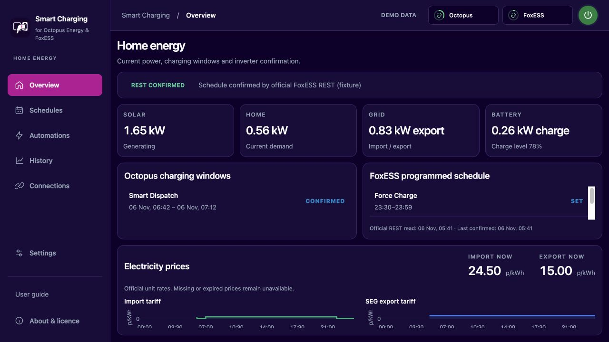
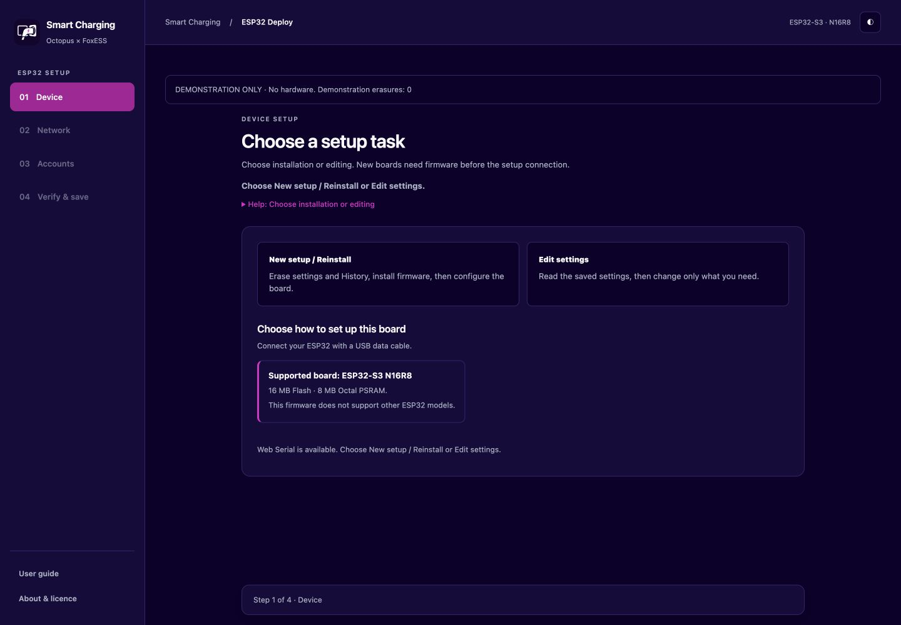
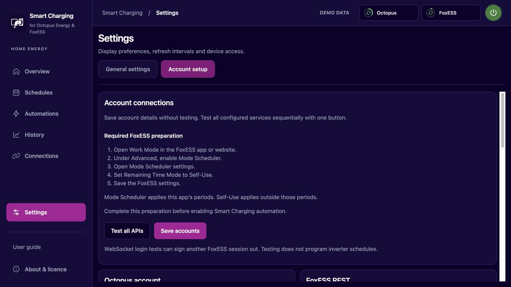
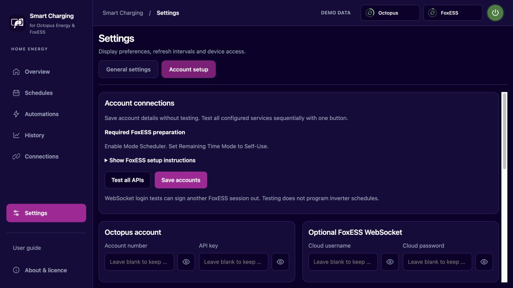
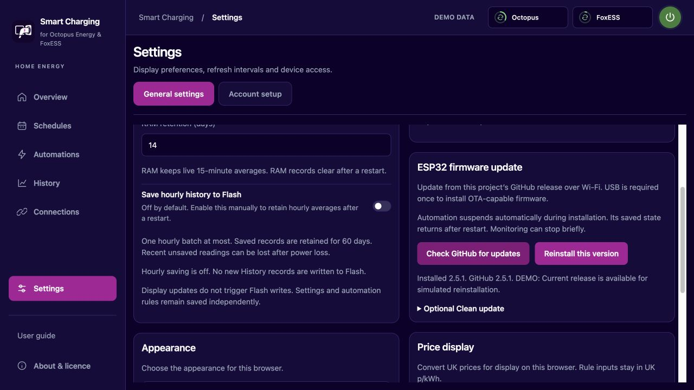
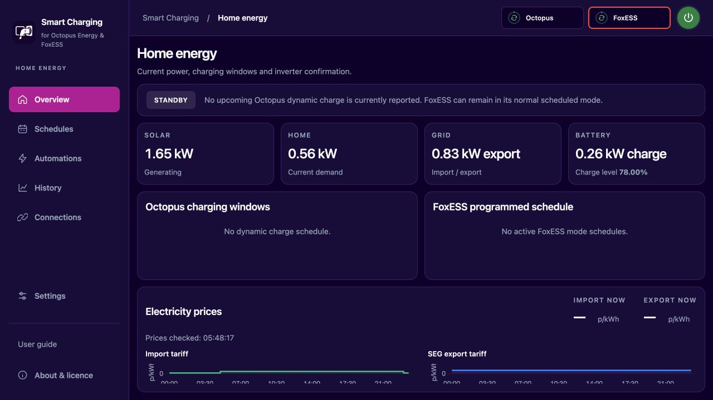
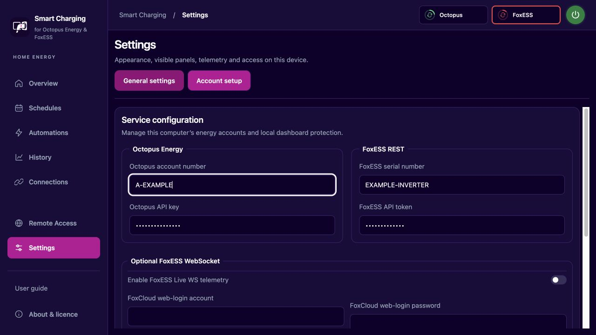
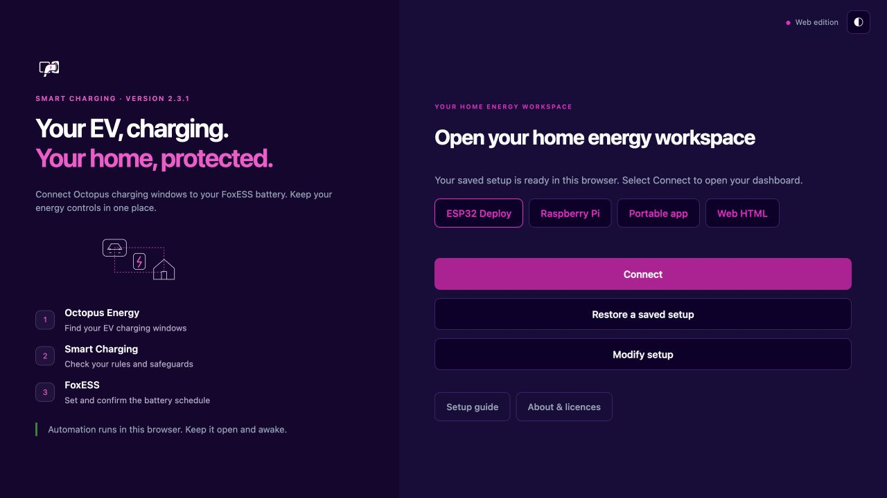
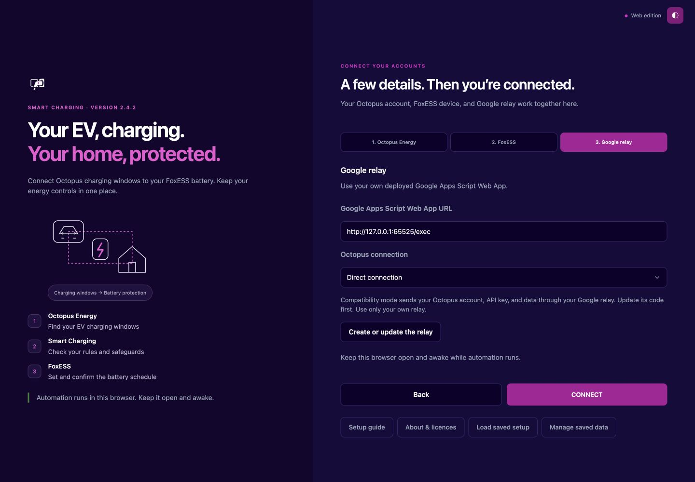
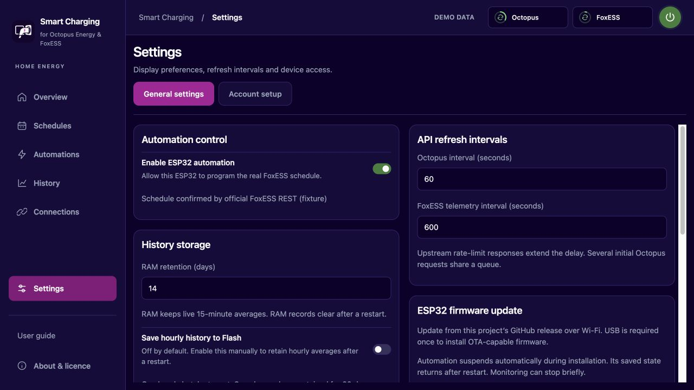

# Interface gallery

[Back to project](../README.md)

All images use dark appearance and isolated demonstration data.
Choose a setup guide from the README when you are ready to deploy.

## ESP32

## Pi

## Portable

## Web

These images show the interface. They do not establish physical inverter behaviour or native Windows verification.

## Compact ESP32 settings

Independent columns remove empty card rows. Mobile uses one column.

