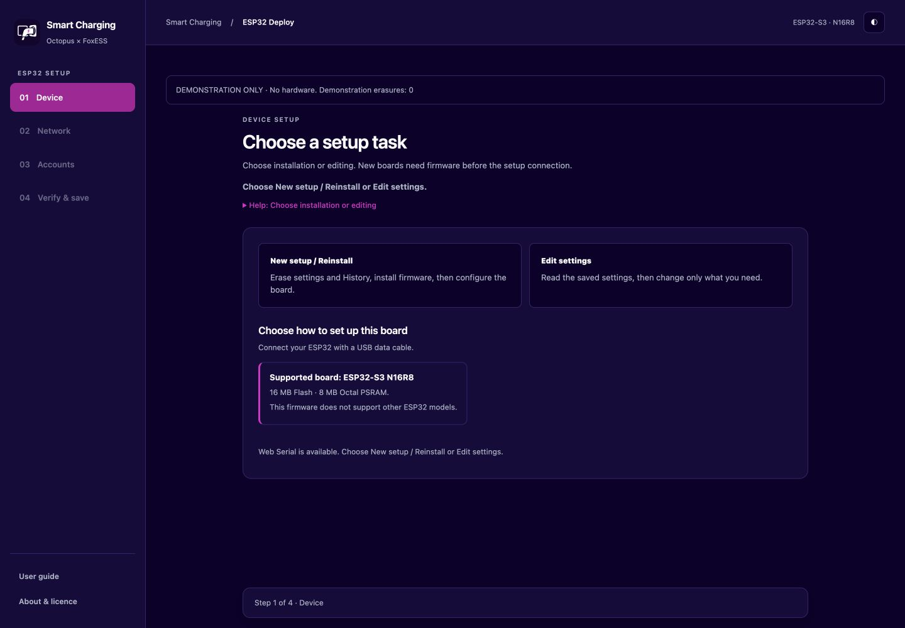
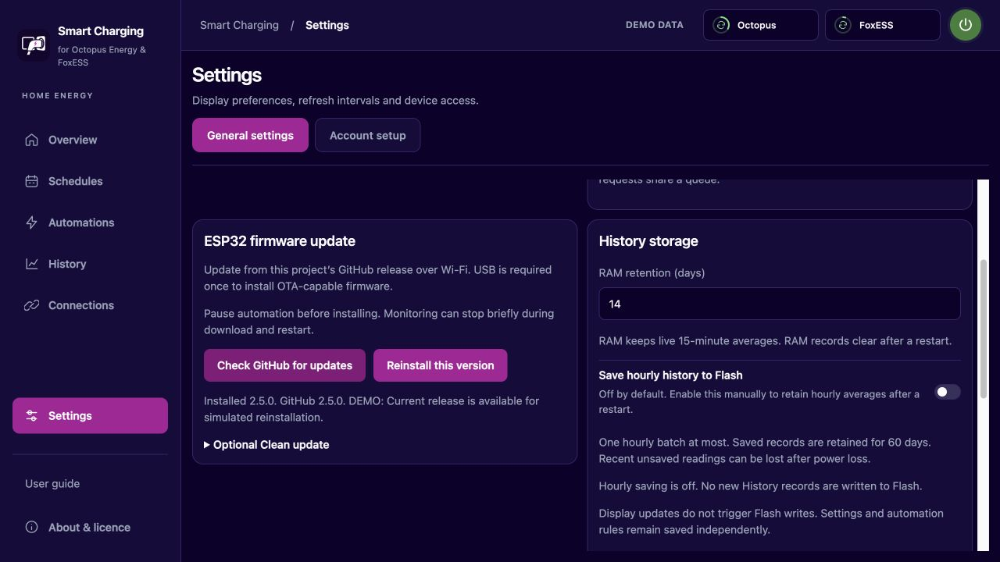

# ESP32 setup

[Back to the project](../../README.md) · [Other editions](../../README.md#choose-your-setup-guide)

[Prepare API keys and optional login](../ACCOUNT-PREPARATION.md).

[Watch the setup video](https://samuelkcc.github.io/octopus-foxess-smart-charging/tutorial/) — 4 minutes 48 seconds, with English narration and captions.
The video covers USB installation, Wi-Fi verification, account setup, dashboard access, and OTA updates.

ESP32 is the recommended compact local controller. The board runs independently while powered.
Your phone or computer displays its dashboard. The setup computer can be disconnected after configuration.

## Before you start

- Use **ESP32-S3 N16R8**, with 16 MB Flash and 8 MB Octal PSRAM.
- Use a USB data cable and 2.4 GHz Wi-Fi.
- Prepare your Octopus account/API key and FoxESS serial number/API token.
- [Prepare the inverter](../PREPARE-INVERTER.md).
- Disable any other automation host for this inverter.

## Choose a deployment tool

| Tool | Open or download |
|---|---|
| USB website | [ESP32 Web Deploy](https://samuelkcc.github.io/octopus-foxess-smart-charging/esp32/) — use desktop Chrome |
| Mac app | [Universal Mac ZIP](https://github.com/samuelkcc/octopus-foxess-smart-charging/releases/download/esp32-2.5.5/SmartCharging-ESP32-Setup-2.5.5-macOS-universal.zip) |
| Windows app | [Windows x64 EXE](https://github.com/samuelkcc/octopus-foxess-smart-charging/releases/download/esp32-2.5.5/SmartCharging-ESP32-Setup-2.5.5-Windows-x64.exe) |

Safari cannot deploy firmware through USB. Safari can display the configured Wi-Fi dashboard.
The Mac and Windows tools provide the same setup flow. They do not run the automation worker.

## Select your task

| Entry | Purpose |
|---|---|
| New setup / Reinstall | Erase settings and History, install firmware, then configure the board |
| Edit settings | Read saved settings, then change only what you need without erasing |

A blank board cannot answer **Connect ESP32**. Select **New setup / Reinstall** to install firmware first.
For a configured board, select **Edit settings**, then **Connect ESP32**.

## Install or reinstall your board

New setup and reinstall both use Clean install.
This permanently erases Wi-Fi, IP, accounts, passwords, automation rules, access protection, and saved History on the ESP32.
It does not change the schedule already stored on the FoxESS inverter.
Automation starts automatically after Wi-Fi and IP settings are saved. Existing operator Pause and disabled states remain unchanged.

1. Select **New setup / Reinstall**.
2. Keep the USB cable connected.
3. If setup is connected, select **Disconnect**.
4. Review the deletion notice.
5. Confirm the supported board model.
6. Confirm deletion of settings and History.
7. Enter **ERASE** in the confirmation field.
8. Select **Erase all & install**.
9. Select the USB-UART port.
10. Wait for installation and hash verification to finish.
11. Select **Continue: Connect ESP32**.
12. Select **Connect ESP32**.
13. Select the USB serial port again.
14. Select **Next: Network**.
15. Configure Wi-Fi and both APIs.
16. Select **Review & save**.
17. Select **Save settings**.
18. Wait for Wi-Fi and IP verification.
19. Open the dashboard address.
20. In **Settings → Account setup**, select **Test all APIs**.

The installer selects its own USB port. A new board does not need a setup connection before installation.
If installation fails after erasure starts, data may already be deleted. Keep USB connected and retry installation.
To retain existing settings, use **Edit settings**. Editing does not reinstall firmware.

## Required FoxESS work mode

1. Open Work Mode in the FoxESS app or website.
2. Under Advanced, enable Mode Scheduler.
3. Open Mode Scheduler settings.
4. Set Remaining Time Mode to Self-Use.
5. Save the FoxESS settings.

Mode Scheduler applies Force Charge during the selected EV charging periods.
Remaining Time Mode returns the inverter to Self-Use outside scheduled periods.
Force Charge can also charge the home battery. Check the configured charge limits and actual battery behaviour.

## Check accounts after deployment

Wi-Fi and IP verification are required before saving. Deployment does not wait for Octopus, FoxESS REST, or optional cloud-login tests.

1. Open **Settings → Account setup** in the local dashboard.
2. Select **Test all APIs**.
3. Read the result for each service.
4. If a check fails, correct its account fields.
5. Pause automation before saving credentials.
6. Select **Save accounts**.
7. Select **Test all APIs** again.

The checks run sequentially. Octopus requests retain their shared cooldown.
A red service badge prompts you to open Account setup. Waiting states do not mean successful authentication.

## Automatic Wi-Fi reconnection

Firmware 2.5.4 and later reconnect after a router restart without a manual ESP32 power cycle.
Attempts continue with delays capped at 30 seconds. Stalled association or IP acquisition times out after 45 seconds.
If Wi-Fi returns, the worker continues with its saved configuration and existing service request limits.
For a changed SSID or password, use USB setup to edit the network settings.

## Update firmware over Wi-Fi

Older firmware needs one USB installation before it can use OTA.
The first USB installation must include the OTA-capable bootloader. New setup / Reinstall erases existing board settings.

1. Open the local dashboard.
2. Open **Settings → General settings → ESP32 firmware update**.
3. Select **Check GitHub for updates**.
4. Review the update notice.
5. Select **Install firmware**.
6. Confirm the selected firmware version.
7. Keep power connected until the ESP32 restarts.
8. Reopen the dashboard.
9. Check the installed version in About & licence.

The download uses verified HTTPS and the published release SHA-256.
The image is written to an inactive partition. Failed verification keeps the current firmware selected.
A new OTA image must pass startup and connection checks. The bootloader can return to the previous working image.
This mechanism does not guarantee recovery from every hardware or Flash failure. USB recovery remains available.

From 2.5.1, installation suspends control automatically without changing your saved automation or Pause state.
After restart, enabled automation resumes with fresh data. A manual Pause remains active.
If installation fails, the previous control state returns automatically.
Firmware 2.5.0 requires manual Pause before its first OTA update. Resume it after that update if required.

Updates keep settings by default. To erase them, open **Optional Clean update** before installing.

1. Select **Erase settings after the verified update**.
2. Enter **ERASE**.
3. Confirm **Erase settings & update**.

Clean update deletes Wi-Fi, accounts, access protection, automation rules, and saved History after a successful boot.
USB configuration is required again. The inverter retains its existing schedule.

## Daily use and limits

- Manage service credentials in **Settings → Account setup** or through USB.
- Use USB for Wi-Fi, IP, and dashboard-port changes.
- Use the optional WebSocket login for live telemetry. Schedule commands still use official REST.
- History uses RAM by default. Optional hourly Flash saving retains hourly records for 60 days.
- Cloudflare, remote relay, and Bluetooth setup are unsupported.
- GitHub OTA is available after one USB installation of firmware 2.5.0 or later.

[User guide](../USER-GUIDE.md) · [Verification limits](../FEATURE-PARITY.md)
