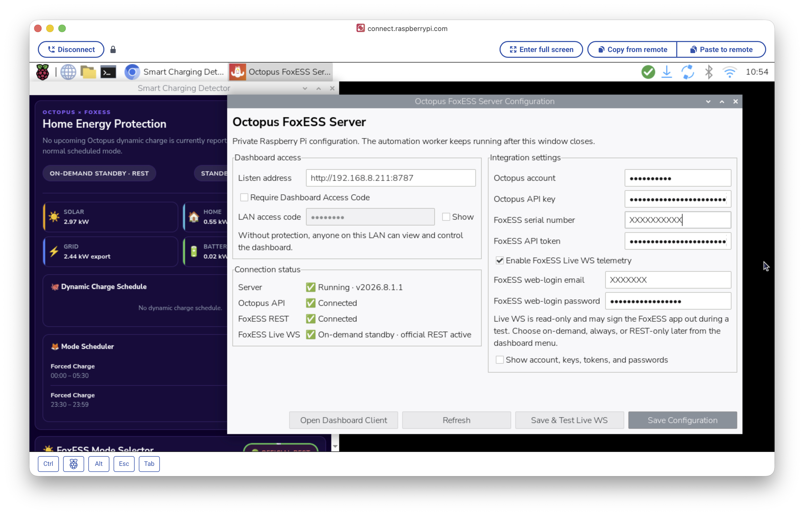

# Pi edition guide

The Pi edition runs the automation as a service.
A browser on your phone or computer displays the dashboard.
Closing that dashboard does not stop the worker.

## Install the public version

Raspberry Pi OS with systemd is required.
The installer requires Node.js 18 or later.
It installs the required packages.

1. Open a terminal on the Pi.
2. Run this command:

```bash
curl -fsSL https://raw.githubusercontent.com/samuelkcc/octopus-foxess-smart-charging/main/linux/install.sh | sudo sh
```

The installer creates three services.

| Service | Function |
|---|---|
| `octopus-foxess` | Provides the dashboard, authentication, and restricted API relay. |
| `octopus-foxess-worker` | Runs unattended automation in a separate Chromium profile. |
| `octopus-foxess-inhibit` | Prevents system sleep and idle suspension. |

The services start after reboot.
The data directory is `/var/lib/octopus-foxess`.
The default LAN port is `8787`.

## Configure accounts

1. Select the charger icon in the Pi taskbar.
2. Select **Configuration…**.
3. Enter the Octopus account number and API key.
4. Enter the FoxESS serial number and API token.
5. Save the settings.
6. Check the Octopus and FoxESS connection states.

The native settings window manages service credentials.
Browser clients do not receive the service API keys or FoxCloud passwords.

| Icon colour | Meaning |
|---|---|
| Green | The connections are healthy. |
| Amber | The service is waiting or using a fallback. |
| Red | A connection or configuration needs attention. |



## Open the LAN dashboard

1. Find the LAN address in **Configuration…**.
2. Open that address on a device in the same network.
3. If access-code protection is enabled, enter the LAN access code.

An example address is `http://192.168.1.42:8787`.
A valid LAN code remains saved on that browser.
**Settings → Access on this device** removes that saved code.

The Pi administrator can disable LAN code protection for a trusted network.
Remote tunnel access always requires its separate key.

## Select telemetry

The Pi supports three telemetry modes.

| Mode | Function |
|---|---|
| Live WS on demand | Uses Live WS during an active Octopus dynamic charge. Uses REST at other times. |
| Always Live WebSocket | Uses Live WS continuously. Uses REST if the live connection fails. |
| Official REST only | Uses the official FoxESS REST API. |

1. To enable Live WS, open **Configuration…**.
2. Enable **FoxESS Live WS telemetry**.
3. Enter the FoxCloud web-login details.
4. Save the settings.
5. Open **Settings → FoxESS telemetry** in the dashboard.
6. Select the required mode.

**Save & Test Live WS** checks a fresh live frame.
The test can sign the FoxESS mobile app out.
Opening the settings window does not start that login test.

The service reuses a valid web-session token for up to 12 hours.
An on-demand test closes its temporary socket after the test.
Missing credentials, stale data, or live-connection failures cause a REST fallback.
The live stream is read-only.
All inverter commands use the official REST API.

## Start remote access

1. Select the charger icon in the Pi taskbar.
2. Select **Remote Access…**.
3. Select **Start Quick Tunnel**.
4. Copy the public URL.
5. Select **Copy Key**.
6. If you use Pi Connect, select its **Copy from remote** button.
7. Open the public URL on your remote device.
8. Enter the Remote Access Key.

The dedicated **Copy Key** button copies the actual key characters.
Copying the hidden password field can copy dots instead.

A Quick Tunnel does not require a Cloudflare account or your own domain.
The installer obtains `cloudflared` from Cloudflare's signed package repository.
Cloudflare terminates HTTPS for the public connection.

| Item | Lifetime |
|---|---|
| Public URL | Remains the same while that tunnel process runs. |
| Browser session | Lasts up to 12 hours. |
| Remote Access Key | Remains valid until you replace it. |

A reboot, app update, or tunnel restart creates a new public URL.
Closing the browser does not change the URL.
After a session expires, the same key can start another session.

**New Key / Sign Out All** invalidates the old key and all remote sessions.
**Stop** closes the public tunnel.
The Pi worker continues to run.

The key contains 256 bits of cryptographic randomness.
The Pi encrypts it in the configuration store.
The browser uses a Secure, HttpOnly, SameSite session cookie.
The app does not save the remote key in browser local storage.

The tunnel uses a dedicated loopback listener, normally port `8788`.
It blocks Pi administration, credential editing, key management, and worker publication.
Do not expose the LAN/admin port `8787` to the internet.
Do not point a public tunnel at that port.

Quick Tunnels have no uptime guarantee.
[Cloudflare documents the current limitations](https://developers.cloudflare.com/tunnel/get-started/quick-tunnels/).
A private VPN is another access option.

API clients can send the key in the `X-Octopus-Remote-Key` header over HTTPS.
The key must not appear in a URL.

## Add a Home Screen shortcut

1. Open the dashboard in Safari on the iPhone or iPad.
2. Sign in.
3. Select **Share → Add to Home Screen**.

On Android, the browser provides **Add to Home screen** or **Install app**.
The shortcut saves the current address.
A changed Quick Tunnel address requires an updated shortcut.
A lasting address requires a stable hostname.
An email login PIN does not recover the app key or update a shortcut.

## Check dispatch confirmation

The worker publishes one current Smart Dispatch state.
Dashboard clients display that state every five seconds.

| State | Meaning |
|---|---|
| SYNCING FOXESS | The worker is writing or checking the schedule. |
| FOXESS CONFIRMED | A fresh official REST readback matches the required schedule. |
| FOXESS SYNC FAILED | FoxESS did not confirm the required schedule. |

A newer dispatch revision takes priority over an older confirmation.
The service rejects stale confirmation results.
A matching schedule readback does not prove measured battery power.

## Use DEV history

History is available in version 2.0.0 under review.
It is not in public v2026.10.26.5.

1. Select **Open Desktop Client** from the taskbar charger menu.
2. Select **History**.
3. Select a month.
4. To enlarge a chart, select its **Expand** button.
5. To save the month, select **Download month CSV**.

The overview shows solar, home demand, grid import/export, battery charge/discharge, and battery level.
The expanded chart closes with **Close** or the Escape key.

The Pi stores 15-minute averages for 12 months by default.
**Settings → History storage** selects a period from 1 to 24 months.
The service automatically erases older power records and activity entries.
A shorter period can permanently erase records.
A longer period cannot restore erased records.
It reuses existing worker telemetry requests.
History adds no upstream API requests.
It records solar, home load, grid import/export, battery charge/discharge, and state of charge.

Collection starts when the DEV version is installed.
Earlier records are not imported.
Missing readings remain gaps.
The values are observed averages, not billing-grade energy totals.

Monthly power archives use gzip compression.
Existing plain archives remain readable.
An active archive converts during its next batch save.
History and Settings show the allocated space for history files.
Settings also shows free disk space and unsaved intervals.
The history files have owner-only permissions.
The files contain no account credentials or remote keys.

## Update the Pi

1. Open **Configuration…**.
2. Select **Update Raspberry Pi Edition**.
3. Approve the Pi OS administrator prompt.
4. Wait for the services to restart.
5. Check the connection states.

The updater installs the latest public GitHub release.
It preserves configuration and history data.
It restarts the tunnel if remote access was enabled.
That restart creates a new public URL.

The public updater currently installs v2026.10.26.5.
On DEV, it returns the Pi to the public edition.
[The DEV guide](../dev/README.md) describes separate development updates.

## Inspect the services

1. To inspect the service state, run this command:

```bash
sudo systemctl status octopus-foxess octopus-foxess-worker octopus-foxess-inhibit
```

2. To read the logs, run this command:

```bash
sudo journalctl -u octopus-foxess -u octopus-foxess-worker -u octopus-foxess-inhibit -f
```

3. If a restart is necessary, run this command:

```bash
sudo systemctl restart octopus-foxess octopus-foxess-worker octopus-foxess-inhibit
```

## Remove the Pi edition

Uninstallation removes the application, services, credentials, access code, and history data.

1. Save any required history or configuration backups.
2. Run this command:

```bash
curl -fsSL https://raw.githubusercontent.com/samuelkcc/octopus-foxess-smart-charging/main/linux/uninstall.sh | sudo sh
```

## Pause schedule control

1. Open **Overview**.
2. Select **Pause automation**.
3. Select **6 hours**, **12 hours**, **24 hours**, or **Forever**.
4. Select **Pause automation** in the dialog.
5. Check the red **Automation paused** banner.
6. Use the FoxESS app to set temporary charging.

The existing inverter schedule stays in place when you pause.
The app sends no schedule commands while paused.
Monitoring continues.
The pause survives a reboot.
**Forever** stays active until you select **Resume automation**.
A timed pause resumes automatically at the displayed time.
After resume, saved app rules can replace your temporary FoxESS settings.
History records pause, manual resume, and timed expiry.

## Check data updates

1. Open **Overview**.
2. Find **Data updates** below the power readings.
3. Check the Octopus and FoxESS countdowns.
4. To request fresh data, select **Update now**.
5. If a red problem button appears, select it.
6. Read the reported problem.
7. After recovery, select **Clear alert**.

The red button remains after recovery until you clear it.
An active failure cannot be cleared as healthy.
The last successful update time remains visible during a failure.
A power value of `0.00 kW` means measured zero.
A value of `--` means the required measurement is unavailable.
Data refresh does not cancel an automation pause.

The same controls appear on desktop and mobile dashboards.
The countdowns use the Pi worker timing when it is available.
**Update now** also requests a worker refresh.
The worker retains control of automatic schedule changes.
Server problem alerts survive a service restart.
Clearing a server alert clears it for all connected Pi dashboards.

## Reduce history writes

Routine readings stay in memory between saves.
The default save interval is one hour.
**Settings → History storage** also provides a 30-minute interval.
A normal service shutdown saves pending readings.
A sudden power failure can lose readings since the last save.
The charts include unsaved readings while the service runs.
Pause activity and preference changes save immediately.
This policy controls history writes, not all operating-system writes.

## Manage low storage

Below 4 GB free space, Overview shows **Low storage**.
The Pi removes the oldest saved history before the selected retention period.
It preserves the newest 24 hours.
If other files keep free space low, the warning remains visible.
The app does not remove unrelated files.

1. Open **Settings → History storage**.
2. Check history disk use and free space.
3. To reduce retention, select **Keep recent 3 months**.
4. Read the confirmation.
5. To apply that period, select **Save settings**.

**Clear all history** removes saved readings, activity, and unsaved readings after confirmation.
It retains account settings, automation rules, and history preferences.
These deletion actions cannot restore erased records.

## Read a local status report

1. Open a Pi terminal.
2. Run this command:

```bash
node /opt/octopus-foxess/current/inspect-runtime.mjs
```

The report includes connection states, dispatch confirmation, readings, history storage, and the public URL.
It uses read-only requests.
It excludes service credentials and the Remote Access Key.
